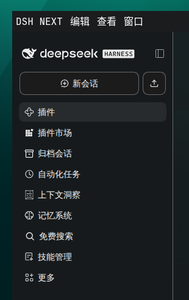
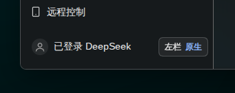
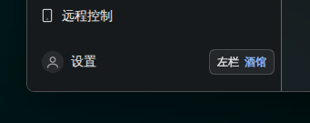
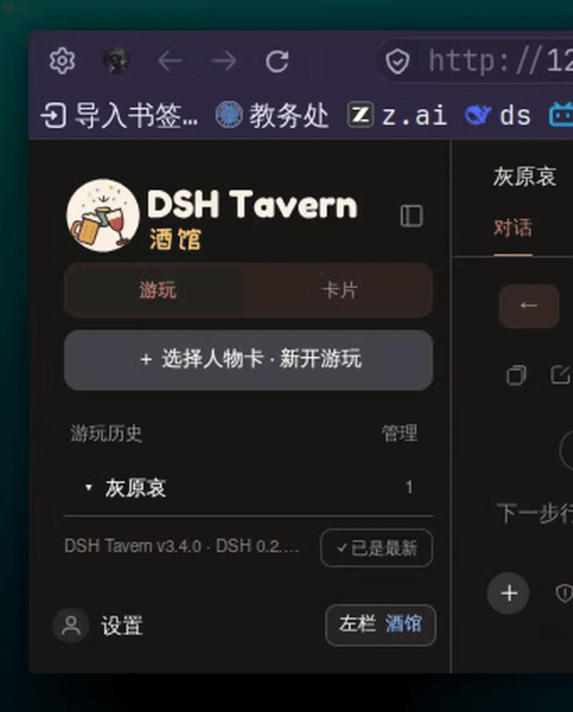

# dsh-tavern-page-switch

中文 | [English](./README.en.md)

把 Tavern 左栏切换为 DeepSeek Harness 原生侧栏，再切回。纯客户端插件：不改 Tavern、不打补丁、不重建。

## 1. 为什么、行为与限制

### 为什么

Tavern 占用了 DSH 的原生左栏。很多人会在 Tavern 上再加装其他 DSH 插件，而很多 DSH 原生页面、原生插件和第三方插件，快捷入口——有时甚至是唯一入口——只在原生左栏。切不回原生左栏，这些入口就找不到。



### 行为

本插件在左栏账号行右侧加一个切换按钮；折叠时按钮移到底部，账号行或槽位缺失时才退回 footer。需要时把左栏换成宿主原生 `WorkspaceBrowser`，再切回 Tavern。它在 `sidebar.workspaces` 注册一条更低优先级的代理，把渲染委托给宿主组件，因而不改 Tavern 的文件和注册。选择保存在 `localStorage`。

- **酒馆模式**（默认）：Tavern 左栏、品牌和外壳保持原样，与未安装插件一致。
- **原生模式**：显示宿主 WorkspaceBrowser；有宿主品牌时替换 Tavern 品牌；插件 CSS 覆盖 Tavern 隐藏宿主控件的规则。
- **账号行按钮**：宽栏时与账号同排、靠右显示 `左栏 原生` 或 `左栏 酒馆`，文字对应当前左栏；点击切到另一种。折叠栏移到左栏最底部，账号行缺失时退回 footer，窄栏只显示 `⇄`。
- **安全降级**：任一页面、账号行或槽位结构缺失时退回 footer；再缺失就隐藏按钮，Tavern 不受影响。
- **持久化**：键 `dsh-tavern-sidebar-style`，值 `tavern` / `native`；storage 事件同步多标签。






### 限制

只切换左栏，对话与右侧面板继续运行。识别依赖宿主声明 `sidebar.workspaces.directoryFlow`、Tavern 声明 `tavern.sidebar.chrome`。账号行按钮依赖宿主 `settings.launcher` 槽与账号按钮的 `data-collapsed` 标记；折叠栏的底部定位还依赖 footer 槽。结构变化时按钮退回 footer。只有官方 DSH 构建才替换宿主品牌。从原生切回不会强制展开左栏。

## 2. 安装

### 插件市场（推荐）

1. 打开 Tavern 设置 → 酒馆插件。
2. 粘贴 `https://github.com/crrvx/dsh-tavern-page-switch` 并安装。
3. 启用并刷新 Tavern；新客户端 bundle 未出现时重启 Tavern。
4. 检测到两侧页面后，宽栏账号行右侧出现按钮；折叠栏在左栏最底部出现 `⇄`。

### profile bundle（手动）

在目标 profile 的 `package.json` 中加入 link 与 bundle，然后安装并重启：

```json
{
  "dependencies": {
    "dsh-tavern-page-switch": "link:/absolute/path/to/dsh-tavern-page-switch"
  },
  "dsh": {
    "profile": {
      "bundles": ["dsh-tavern-page-switch"]
    }
  }
}
```

```sh
cd /path/to/profile
pnpm install
```

保留原有 bundles，只追加本插件。仅刷新页面不会加载新 link 的 bundle。

## 3. 依赖、开发与服务契约

### 依赖

- 支持客户端插件与 `slots` 服务的 DeepSeek Harness web。
- Tavern 3.4.0（已验证），或把左栏页注册在 `sidebar.workspaces`、priority 低于宿主页的版本。
- 不需要补丁、改 Tavern 文件或重建 Tavern。

### 开发

```sh
node build.mjs          # 重建 lib/client.js
node build.mjs --check  # 过期则失败
node --test tests/      # 40 个测试
```

`lib/client.js` 是生成文件。源码在 `src/client/`（`core`、`shadow`、`switch-button`、`login-row`、`rail-button`、`styles`、`main`）；`build.mjs` 负责包装为 DSH 模块。

### 服务契约

```js
const service = ctx.get("tavernPageSwitch");
service.getMode();       // "tavern" | "native"
service.setMode(value);  // 归一化、持久化、应用、通知
service.isAvailable();   // 两页都检测到
service.getSnapshot();   // 冻结的 { mode, available }
service.subscribe(fn);   // 返回取消订阅函数
```

## 4. 其他

**0.1.x 不可用**：它依赖给 Tavern 打接缝补丁。0.2.x 不需要；如果装过旧补丁，用备份恢复那 4 个 Tavern 文件，或重装 Tavern。

**验证**：插件测试 40/40 通过；headless Chrome 组件验收覆盖宽栏账号行同排、折叠栏底部定位和无账号行降级。

**许可**：`AGPL-3.0-or-later`，全文见 [LICENSE](LICENSE)。源码：https://github.com/crrvx/dsh-tavern-page-switch。若把修改版作为网络服务运行，请保留 Corresponding Source（AGPL §13）。0.2.0 及更早为 MIT，0.2.1 起为 AGPL。
