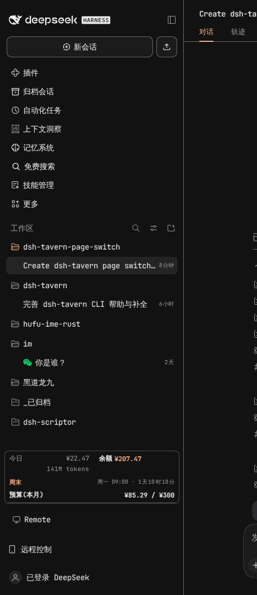
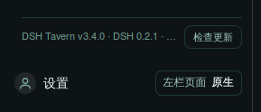

# dsh-tavern-page-switch

Chinese: [README.zh-CN.md](README.zh-CN.md)

Switch the Tavern left sidebar to the host's native sidebar and back. Pure client plugin: no Tavern changes, no patch, no rebuild.

## 1. Why, behaviour and limits

### Why

Tavern takes over DSH's native left sidebar. People often add more DSH plugins on top of Tavern, and many DSH pages, native plugins and third-party plugins put their shortcut — sometimes their only entry — in that native sidebar. If you cannot get back to it, those entries are missing.



### Behaviour

This plugin adds a footer button that swaps Tavern's left column for the host's native `WorkspaceBrowser` when needed, then restores Tavern. It registers a lower-priority delegate for `sidebar.workspaces` and asks the host component to render, so Tavern's files and registrations stay untouched. The choice is stored in `localStorage`.




- **Tavern mode** (default): Tavern page, brand and chrome; identical to not installing the plugin.
- **Native mode**: host WorkspaceBrowser renders; the host brand replaces Tavern's when available; injected CSS overrides Tavern's host-chrome hiding.
- **Footer button**: `左栏页面`; hidden until both pages are detected. Narrow footers show `⇄`.
- **Safe fallback**: if a page or the expected slot shape is missing, the button hides and Tavern is untouched.
- **Persistence**: key `dsh-tavern-sidebar-style`, values `tavern` / `native`; storage events sync tabs.

### Limits

Only the left column changes; conversation and right panels keep running. Detection expects the host to declare `sidebar.workspaces.directoryFlow` and Tavern to declare `tavern.sidebar.chrome`. The host brand is replaced only on official DSH builds. Returning from native does not force-expand the column.

## 2. Install

### Marketplace (recommended)

1. Open Tavern settings -> Tavern plugins.
2. Paste `https://github.com/crrvx/dsh-tavern-page-switch` and install.
3. Enable it and refresh Tavern; restart Tavern if the new client bundle does not appear.
4. The footer button appears after both pages are detected.

### Profile bundle (manual)

Add the link and bundle to the target profile's `package.json`, then install and restart:

```json
{
  "dependencies": {
    "dsh-tavern-page-switch": "link:/absolute/path/to/dsh-tavern-page-switch"
  },
  "dsh": {
    "profile": {
      "bundles": ["dsh-tavern-page-switch"]
    }
  }
}
```

```sh
cd /path/to/profile
pnpm install
```

Keep existing bundles and append only this one. A page refresh alone does not load a new linked bundle.

## 3. Requirements, development and service contract

### Requirements

- DeepSeek Harness web with client plugins and the `slots` service.
- Tavern 3.4.0 (verified), or a version that registers its left page in `sidebar.workspaces` at a lower priority than the host page.
- No Tavern patch, modified files or rebuild.

### Development

```sh
node build.mjs          # rebuild lib/client.js
node build.mjs --check  # fail if stale
node --test tests/      # 24 tests
```

`lib/client.js` is generated. Source lives in `src/client/` (`core`, `shadow`, `switch-button`, `styles`, `main`); `build.mjs` wraps it in the DSH module loader.

### Service contract

```js
const service = ctx.get("tavernPageSwitch");
service.getMode();       // "tavern" | "native"
service.setMode(value);  // normalize, persist, apply, notify
service.isAvailable();   // both pages detected
service.getSnapshot();   // frozen { mode, available }
service.subscribe(fn);   // returns unsubscribe
```

## 4. Other

**0.1.x is not usable**: it depended on a Tavern seam patch. 0.2.x needs none. If the old patch was applied, restore the four Tavern files from its backup or reinstall Tavern.

**Verification**: 24/24 plugin tests pass; manual CLI Tavern 3.4.0 check with system Chrome covered the toggle, reload persistence, the 900px button and page errors.

**License**: `AGPL-3.0-or-later`; full text in [LICENSE](LICENSE). Source: https://github.com/crrvx/dsh-tavern-page-switch. If you run a modified copy as a network service, keep its Corresponding Source available (AGPL §13). 0.2.0 and earlier were MIT; 0.2.1 and later are AGPL.
